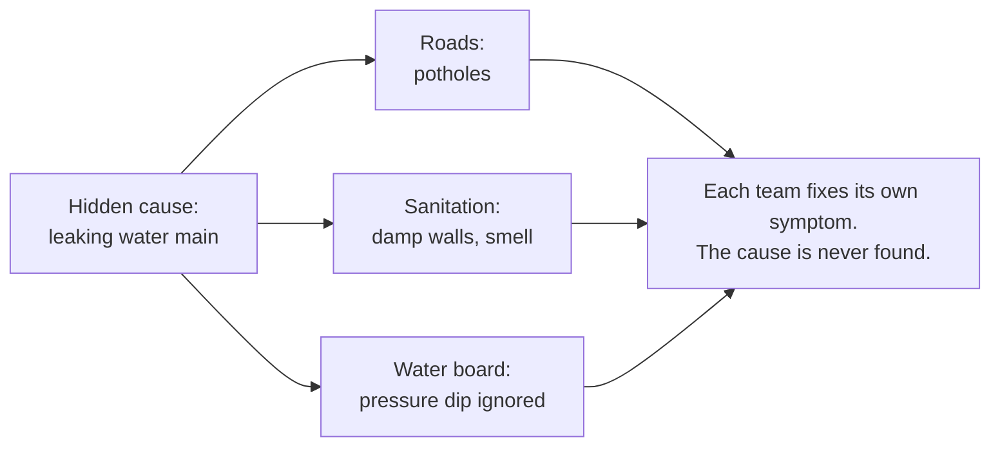
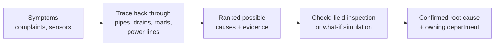

# CitySense

**CitySense finds the root cause behind city complaints.**

A pothole that keeps coming back, a street that goes dark, a jam that starts every evening: each usually has a
cause somewhere else, often in another department's system. CitySense traces the symptoms back to that cause,
shows the evidence and names the department that owns it. A person decides what to do.

> All results below are **simulated**: a synthetic city and a traffic digital twin with planted causes.

📐 **How it works in depth:** [architecture.md](architecture.md)

---

## The problem

Departments keep separate data. One hidden fault shows up as symptoms in several of them, and each department
only sees its own piece.



So crews patch potholes that a leaking main keeps destroying, and the complaints keep coming.

**CitySense asks:** given these complaints and sensor readings, *what is the most likely cause, where is it,
when did it start, and who owns it?*

---

## The approach



1. **Collect** every complaint and sensor reading with its place and time.
2. **Trace** each symptom back through the city's networks to the assets that could explain it.
3. **Rank** the possible causes by how well they explain the evidence.
4. **Check** the top candidates. A reinforcement-learning (RL) policy decides what to inspect first. For
   traffic, the digital twin replays the jam with each candidate cause removed.
5. **Confirm** a cause only when a check proves it. Until then it stays a hypothesis.

The same idea runs on **civic complaints** (water, sewer, waste, streetlights, crime) and on **traffic jams**.
LLMs only explain the result in plain language; they never decide the cause.

---

## Results (simulated)

**Traffic: is the top-ranked cause correct?** 6 cases × 3 signal policies × 3 seeds.

| Case | Top cause correct | Origin error (cells of 15 m) |
|---|---|---|
| recurring_capacity_drop | 88% (23/26) | 0.00 |
| creeping_capacity_drop | 62% (15/24) ← weakest | 1.79 (max 11) |
| downstream_spillback | 96% (25/26) | 1.00 |
| demand_surge | 100% (27/27)\* | – |
| control / demand_peak_shift | 100% (7/7, 8/8) | – |
| **Overall** | **89% (105/118)**; capacity cases alone 83% (63/76) | |

\* Demand is named as the top cause in 78% of demand_surge runs; the other 22% name a signal fault, which the
benchmark counts as correct.

**Civic: who finds the planted cause?** 5 cause types plus a mixed scenario.

| Strategy | Causes identified | False repairs / episode |
|---|---|---|
| RL (Double DQN) | 100% in every scenario | 1.8 – 3.8 |
| Tracer (deterministic) | 87 – 100% | ~0.05 |
| Complaint count (today's practice) | 76 – 100% | 41 – 48 |
| Random | 87 – 100% identified, only 50 – 93% fixed | ~31 |

**Traffic signal control in the twin** (mean queue, lower is better): max-pressure 163.1 · longest-queue 165.6 ·
DoubleDQN 171.0 · fixed-time 234.1.

**In short:** chasing complaints wastes the most repairs. RL finds every planted cause fastest but repairs
healthy assets more often than the careful tracer. RL does not beat classic signal controllers; its role in
traffic is to make the what-if replays realistic. Full analysis: [architecture.md § 9](architecture.md#9-results-in-detail).

---

## What's in the repo

| Folder | Part |
|---|---|
| `civic_sim/` | Synthetic city with hidden faults; civic root-cause pipeline |
| `CITY SENSE RL/` | Traffic digital twin of Rajpur–Mussoorie Road, Dehradun; traffic root-cause pipeline |
| `city_sim/` | Neighbourhood agents (local LLM) that create traffic in the twin |
| `dashboard/` | Operations dashboard: 3D map, live jams, root-cause evidence |
| `mobile/` | Citizen app: voice agent, report and track complaints |
| `agent_service/` | Hindi/English voice agent with verified answers |
| `complaint_module/` | Complaint assignment and escalation |
| `emergency_routing/` | Ambulance dispatch and routing |
| `core/` | Gateway: login, maps, city events, live updates |

---

## Run it

```bash
cp .env.example .env && ./scripts/gen-secrets.sh .env   # then add GROQ_API_KEY, SARVAM_API_KEY
./run_backends.sh start                                  # Python services + dashboard
# open http://localhost:5173  →  Dashboard (Root cause) and Civic Sim
```

Docker deployment: [docs/DEPLOYMENT.md](docs/DEPLOYMENT.md) · Database: [docs/DATABASE.md](docs/DATABASE.md)
