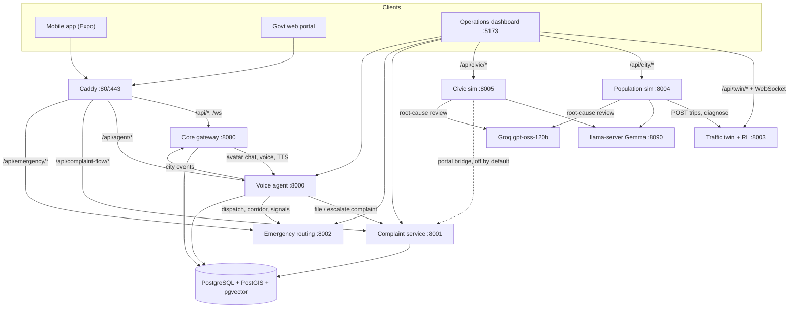
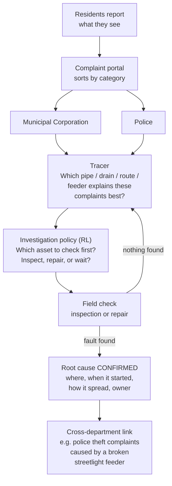
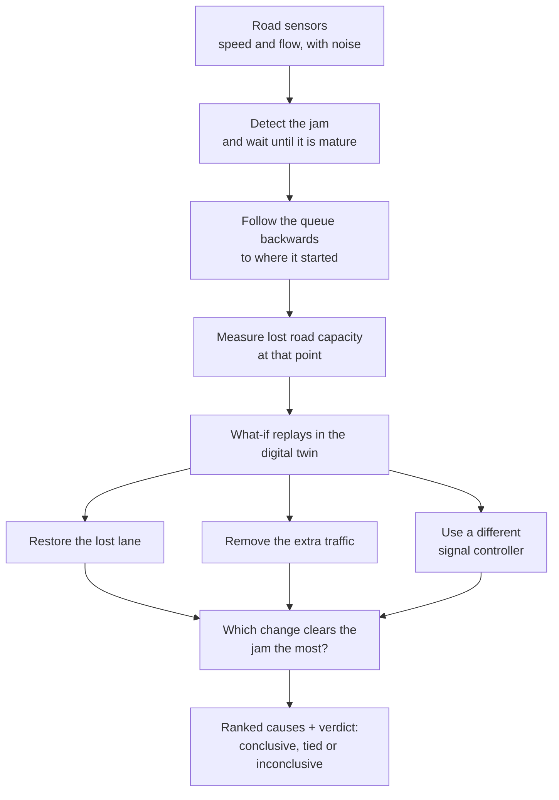

# CitySense architecture

This document explains how CitySense works in depth: the services, how they connect, the two root-cause
pipelines step by step, how the results were measured and what they mean. For a short overview, see
[README.md](README.md).

All root-cause results are **simulated** (a synthetic civic city and a CTM traffic twin with planted causes).
Emergency dispatch runs on a synthetic road network. Nothing acts on real city infrastructure.

**Contents**

1. [Core principle](#1-core-principle)
2. [Services](#2-services)
3. [Topology](#3-topology)
4. [Public routing](#4-public-routing-caddy)
5. [Root-cause pipeline A: civic complaints](#5-root-cause-pipeline-a-civic-complaints)
6. [Root-cause pipeline B: traffic jams](#6-root-cause-pipeline-b-traffic-jams)
7. [Where RL fits](#7-where-rl-fits)
8. [LLMs explain, they never decide](#8-llms-explain-they-never-decide)
9. [Results in detail](#9-results-in-detail)
10. [Citizen-facing flows](#10-citizen-facing-flows)
11. [Data](#11-data)
12. [Tests](#12-tests)
13. [Known limits](#13-known-limits)

---

## 1. Core principle

A complaint is a **clue**, not a job. CitySense collects clues, follows them back through the city's
networks (water mains, sewers, waste routes, streetlight feeders, roads) and ranks the possible causes.

* A cause counts as **confirmed** only after a check proves it: a field inspection or repair in the civic
  simulator, or a counterfactual replay in the traffic twin.
* Until then it is shown as a **hypothesis**, with the evidence that supports it.
* Deterministic code decides causes and rankings. RL decides *what to check next*. LLMs only *explain*.
* A person decides what to do about the cause.

---

## 2. Services

| Service | Dir | Port | Stack | Role |
|---|---|---|---|---|
| Core gateway | `core/` | 8080 | Spring Boot 3, Java 21 | Auth (JWT, email OTP), maps/geocoding/routing proxy, avatars, city events, incidents, live STOMP events, offline mesh |
| Voice agent | `agent_service/` | 8000 | FastAPI, Python 3.11 | Guardrails → planner → specialist sub-agents; RAG over a verified corpus (pgvector); Sarvam STT/TTS |
| Complaint service | `complaint_module/` | 8001 | FastAPI + LangGraph | Complaint lifecycle: intake classification, worker assignment, SLA escalation ladder; government notices |
| Emergency routing | `emergency_routing/` | 8002 | FastAPI + LangGraph | Ambulance dispatch, green-wave corridors, CCTV triage (YOLOv8), weather-aware routing |
| Traffic digital twin + RL | `CITY SENSE RL/` (`scripts/serve_twin.py`) | 8003 | Python, PyTorch | CTM corridor, online Double DQN signal control, **traffic root-cause pipeline** |
| Population simulator | `city_sim/` | 8004 | FastAPI + LangGraph | Neighbourhood agents on local Gemma; trips become car clusters in the twin; LLM review of traffic root causes |
| Civic simulator | `civic_sim/` | 8005 | FastAPI, NumPy | Synthetic city with hidden faults; **civic root-cause pipeline** with an RL investigation policy |
| Local LLM | llama-server | 8090 | llama.cpp, Gemma-4-E2B | Agent decisions and short explanations (JSON-schema constrained) |
| Operations dashboard | `dashboard/` | 5173 | React + Vite, MapLibre + deck.gl | 3D twin, root-cause drawers, Policy Lab, Civic Sim, complaints, missions |
| Database | `db/` | 5432 | PostgreSQL 16 + PostGIS + pgvector | One instance, one schema per owning service |
| Reverse proxy | `Caddyfile` | 80 / 443 | Caddy 2.8 | Public entrypoint, TLS, public/LAN route guards, static govt portal |

Clients: the citizen **mobile app** (`mobile/`, Expo) talks to core and the complaint service; the
**govt web portal** (separate repo `govt_website`, served by Caddy at `/` or on Vercel) reads complaints and
notices from the complaint service.

---

## 3. Topology



### Two ways it runs

| Mode | Command | What starts |
|---|---|---|
| Local dev | `./run_backends.sh start` (`stop`, `status`) | 8000, 8001, 8002 from `SmartCity/.venv`; twin 8003 from the RL repo's `.venv`; llama-server 8090; 8004; 8005; Vite 5173. Logs go to each service's `service.log`. Core and Postgres come from docker compose. |
| Docker | `docker compose up -d --build` | postgres-postgis, core, agent-service, complaint-module, emergency-routing, reverse-proxy |

The twin (8003), population sim (8004) and civic sim (8005) are **not** in docker compose or the Caddyfile.
The dashboard reaches them through the Vite dev proxy (`dashboard/vite.config.js`), so the root-cause demo
runs on the local-dev path.

---

## 4. Public routing (Caddy)

| Path | Upstream | Rewrite |
|---|---|---|
| `/api/agent/*` | agent-service:8000 | none (120 s read timeout for LLM/speech) |
| `/agent/*` | agent-service:8000 | strip `/agent` |
| `/api/complaint-flow/api/*` | complaint-module:8001 | strip `/api/complaint-flow` |
| `/api/complaint-flow/*` | complaint-module:8001 | `/api/complaint-flow/x` → `/api/x` |
| `/api/emergency/*` | emergency-routing:8002 | `/api/emergency/x` → `/api/x` |
| `/api/*`, `/ws*`, `/avatars/*`, `/actuator/health*`, `/swagger-ui*`, `/v3/api-docs*`, `/*.apk` | core:8080 | none |
| everything else | static govt portal (`PORTAL_DIR`) | `try_files` |

Requests on the public host (`PUBLIC_HOST`, the ngrok domain) are limited to what the citizen app needs.
Operator tools return 403 there: `/agent/*`, `/api/emergency/*`, complaint escalate/resolve/reassign, and
notice writes without an `X-Operator-Key` header (the complaint service checks the key's value).

---

## 5. Root-cause pipeline A: civic complaints

`civic_sim/`, port 8005. A 6×6-block synthetic city (9 wards, 360 residents). Hidden causes create symptoms;
residents report them; two departments (Municipal Corporation, Police) investigate.



### The world

| Cause (layer) | Department | Where symptoms appear |
|---|---|---|
| `water_main_leak` | Municipal | low pressure downstream, potholes over the leak, arterial jams |
| `sewer_blockage` | Municipal | overflow and smell upstream, spreading one hop per tick |
| `missed_waste_route` | Municipal | garbage on the route, then stray animals, then choked drains |
| `streetlight_feeder_fault` | Municipal | dark streets, then theft and harassment reported to **Police** |
| `crime_hotspot` | Police | theft, disorder, harassment spreading outward |
| none (random potholes, background traffic) | both | symptom-only noise |

Background noise in every category, random potholes and per-ward under-reporting are on in every episode.
Symptom-only actions (local desilting, patrols, marshals) hide symptoms for a few ticks, which is why chasing
complaints *looks* like it works. 1 tick = 6 simulated hours. Every rate is an assumption in `config.yaml`.

### Step by step

1. **Collect** (`app/citizens.py`, `app/portal.py`). Residents report what they see, with place, time and
   category. The taxonomy mirrors `complaint_module`'s intake classifier, extended with police categories.
   Local Gemma rewrites a few complaints per tick in the resident's words; text with digits is rejected.
2. **Trace** (`app/tracer.py`, deterministic). Reads only public data: complaint log, work log, infrastructure
   maps and the mechanism table. For every asset it asks *if this asset were faulty, would it explain the
   complaints we see?* It measures coverage of the asset's zone, lift over the city average, and whether the
   asset's own block reported first. It proposes up to 71 candidates per department (inspect/repair per
   asset, plus wait), each a 30-feature vector.
3. **Choose what to check** (`app/dqn.py`, `app/policies.py`). The RL policy scores the candidates and picks
   one action per department per tick.
4. **Confirm** (`app/env.py`, `app/diagnosis.py`). Only an inspection or repair that finds the fault confirms a
   cause. The report gives location, onset (CUSUM change point on the zone's complaints), mechanism, spread,
   and complaints that went to the other department. Unconfirmed candidates are labelled `HYPOTHESIS`.
5. **Explain** (`app/reasoning.py`). An LLM reviews the confirmed cause or hypothesis (see section 8).

### RL formulation

* **Q-network:** Q(s, a) = MLP(features of candidate a). One network shared by both departments
  (department one-hot feature). Double DQN targets over the next state's valid candidates, Huber loss, Adam,
  written in NumPy and gradient-checked in tests.
* **Reward (team):** −0.1 per severity-weighted new complaint, −crew cost per inspection/repair, −penalty for
  repairing a healthy asset, +bonus when a true cause is first confirmed, +bonus when it is removed.
* **Training:** 1200 episodes, 1–2 random causes each. The first 150 follow the tracer (teacher-forced, to put
  successful diagnoses in the replay buffer), then ε-greedy from 1.0 to 0.05 over 900 episodes.
  Checkpoint: `data/civic_dqn.npz`.
* **Evaluation** (`app/evaluate.py`): held-out seeds from 300000, identical across policies (paired), one
  scenario per cause type plus `mixed` and `control`. Baselines: `tracer`, `complaint_count` (repair whatever
  has the most complaints on its own block, i.e. today's practice) and `random`.
  Output: `reports/civic_rl_results.{md,json}`.

Endpoints: `GET /api/civic/health | map | state | complaints | diagnosis | traces | last_episode`,
`POST /api/civic/control | reset | root-cause | explain`.

---

## 6. Root-cause pipeline B: traffic jams

`CITY SENSE RL/`, port 8003.

### The twin

A Cell Transmission Model (CTM) of 10 signalised junctions on 2.64 km of arterial (176 cells × 15 m), plus two
180 m side-road legs per junction, drawn on Rajpur–Mussoorie Road, Dehradun. One engine per signal policy
(Double DQN, fixed-time, longest-queue, max-pressure) runs in lockstep on identical demand, so comparisons are
like-for-like. A safety shield enforces minimum green and maximum cycle outside the learned policy. The DQN
learns online; every phase decision is logged with explore/exploit/shield mode, Q-values and gradient×input
attributions.

### Step by step (`POST /api/twin/diagnose {cell}`, `src/citysense/live/diagnose.py`)



1. **Detect** (`JamDetector`). Each run keeps 15 min of noisy sensor observations (10% flow noise). A jam is
   traced only after the twin has confirmed it for 180 s (maturity gate), so red-light queues are ignored.
   Younger requests return `immature` with `retry_after_sec`.
2. **Find the origin** (`ShockwaveTracer`). A queue grows backwards from its cause; the tracer follows the
   shockwave back to the discharge front. For chained bottlenecks, internal discharge fronts and junction stop
   lines inside the jam are also tried as origin candidates.
3. **Measure capacity** (`CapacityEstimator`). Fits the lost capacity at the origin (triangular fundamental
   diagram, CUSUM change point).
4. **Test each explanation** (counterfactual ladder). Copies of the live engine are replayed from a snapshot
   taken before the jam, through now and 600 s forward, 5 replicates each with perturbed demand, with real
   signal controllers in every rung:

   | Rung | What the replay changes |
   |---|---|
   | baseline | nothing (running signal policy) |
   | `restore_capacity` | restores capacity at the origin (and at other origin candidates) |
   | `demand_peak_shift` | best of: retime the background peak, or thin a detected trip surge |
   | `rl_signal_control` | best alternative signal controller (DQN greedy, fixed-time, longest-queue, max-pressure) |

5. **Verdict** (`build_situation`). The rung that recovers the most vehicle-hours ranks first. `conclusive`
   means it is above the minimum effect and its 95% interval is clear of the next rung; otherwise `tied` or
   `inconclusive`. The planted ground truth is returned only under `validation`; the pipeline and the LLM never
   see it. Runtime: about 5–18 s per trace.

Benchmark: `scripts/benchmark_live_diagnosis.py` → `reports/live_diagnosis_benchmark.md`
(6 cases × 3 running policies × 3 seeds, pinned DQN checkpoint). Controller comparison:
`reports/final_results.md`.

Other twin endpoints: `GET /api/twin/topology | state | events | decisions | episodes | platoons | health`,
`POST /api/twin/control | trips`, `WS /api/twin/stream`.

### Population simulator (`city_sim/`, 8004)

28 randomly placed neighbourhoods (24 000 people). One LangGraph agent per neighbourhood:
`observe → decide (Gemma, JSON schema) → validate → dispatch | rule fallback`. The LLM picks categories
(intent, departure, share); code turns them into car clusters posted to `/api/twin/trips`. Realised delay
feeds back into the next decision, so congestion caused by the signal policy changes demand.

---

## 7. Where RL fits

| RL does | RL does **not** |
|---|---|
| Decides which suspected asset a crew should inspect or repair first (civic) | Decide what the cause is |
| Controls the traffic signals inside the twin, so what-if replays behave like a responsive city | Act on the real city |
| Is one of the controllers compared in the traffic ladder | Write the explanation |

---

## 8. LLMs explain, they never decide

| Use | Model chain | Guardrail |
|---|---|---|
| Root-cause review (`/api/city/root-cause`, `/api/civic/root-cause`) | Groq `openai/gpt-oss-120b` → `gpt-oss-20b` → local Gemma → deterministic summary | Ground truth and scenario names stripped from evidence (a test enforces this for civic); every number in the answer is checked against the evidence and unmatched ones are returned in `ungrounded_numbers`; the ranking stays deterministic and the model must say whether it agrees |
| Decision explanations (`/api/city/explain`, `/api/civic/explain`) | local Gemma | A reply with any number not in the decision record is replaced by the deterministic explanation |
| Resident complaint text (civic), travel plans (city) | local Gemma | Categories only; text with digits rejected; rule fallback on any failure, marked in the trace |
| Voice agent | Groq / Sarvam, local fallback | Input guardrail + scope classifier; abstain when retrieval cannot support an answer; side-effect tools create a pending action the citizen must confirm |
| Complaint intake | Groq / Gemini | Category and department only; worker assignment and escalation are code |

API keys come from `.env` (`GROQ_API_KEY`, `SARVAM_API_KEY`, `GEMINI_API_KEY`) and are never logged.

---

## 9. Results in detail

### 9a. Traffic: is the top-ranked cause correct?

Source: `CITY SENSE RL/reports/live_diagnosis_benchmark.md`. 1 cell = 15 m.

| Case | Top cause correct | Origin error (cells) |
|---|---|---|
| recurring_capacity_drop | 88% (23/26) | 0.00 |
| creeping_capacity_drop | 62% (15/24) ← weakest | 1.79 (max 11) |
| downstream_spillback | 96% (25/26) | 1.00 |
| demand_surge | 100% (27/27)\* | – |
| control / demand_peak_shift | 100% (7/7, 8/8) | – |
| **Overall** | **89% (105/118)**; capacity cases alone 83% (63/76) | |

\* For demand_surge, demand is named as the top cause in only 78% of runs. The other 22% name a signal fault,
which the benchmark still counts as correct.

### 9b. Civic: finding the planted cause

Source: `civic_sim/reports/civic_rl_results.md`. Ranges cover the 5 cause types plus `mixed`.

| Policy | Planted causes identified | Time to find the cause (ticks) | False repairs / episode |
|---|---|---|---|
| RL (Double DQN) | 100% in every scenario | 0.03 – 3.4 | 1.8 – 3.8 |
| Tracer (deterministic) | 87 – 100% | 1.7 – 5.3 | ~0.05 |
| Complaint count (today's practice) | 76 – 100% | 2.8 – 8.9 | 41 – 48 |
| Random | 87 – 100% identified, only 50 – 93% fixed | 5.6 – 13.6 | ~31 |

### 9c. Signal control inside the twin

Source: `CITY SENSE RL/reports/final_results.md`. Lower is better.

| Controller | Mean queue (vehicles) |
|---|---|
| max-pressure | 163.1 |
| longest-queue | 165.6 |
| DoubleDQN | 171.0 |
| fixed-time | 234.1 |

### What the numbers show

* **Complaint-chasing is the weakest strategy.** It makes 41–48 wasted repairs per episode and finds causes slowest.
* **RL finds every planted cause and finds it fastest, but repairs healthy assets more often than the tracer**
  (about 2–4 vs about 0.05 per episode). In `control` episodes (no planted cause) RL also produced more
  complaints than the tracer (394 vs 300).
* **RL does not beat classic traffic controllers.** Max-pressure and longest-queue give shorter queues. RL's
  value for traffic here is a responsive twin for the what-if replays, not a better signal plan.
* **Slow, creeping capacity loss is the hardest traffic case** (62%), because its queue builds gradually.
* The signal benchmark is deterministic per seed, so it reports a single value with no spread.

Reproduce:

```bash
cd civic_sim && OMP_NUM_THREADS=1 ../../.venv/bin/python -m app.evaluate
cd "CITY SENSE RL" && .venv/bin/python scripts/benchmark_live_diagnosis.py
```

---

## 10. Citizen-facing flows

**Voice → plan → action.**

1. The app records audio → `POST /api/agent/voice` (Sarvam `saaras:v3`, Groq Whisper fallback).
2. `POST /api/avatars/{id}/chat` on core → forwarded to `agent-service /api/agent/chat` with the citizen's JWT and GPS.
3. Input guardrail + scope classifier → `VoiceAgentPlanner` builds steps, each owned by one specialist
   (`tool_registry.TOOL_OWNERS`): emergency (dispatch, corridor, signal pre-emption), complaint (draft + confirm
   token), city pulse (events, traffic, weather, AQI), knowledge (RAG).
4. On **Confirm**, the complaint goes to `POST complaint-module /api/complaints` with any photo.
5. The reply is spoken via `POST /api/agent/tts/clips` (Sarvam `bulbul:v3`).

**Complaint lifecycle** (`complaint_module/app/graph.py`, LangGraph):
`INTAKE → intake_classifier → worker_dispatcher`; `ESCALATE → sla_governor (warnings 1–5) → authority_escalator`;
`RESOLVE → resolution_handler → citizen_notifier`. Endpoints: `GET/POST /api/complaints`,
`POST /api/complaints/{id}/escalate-tick | resolve | reassign`, `GET /api/feed`, `GET /api/meta`, notices.

---

## 11. Data

One PostgreSQL 16 instance; each service owns one schema and is its only writer. Services talk over HTTP,
never through each other's tables. Full table list: [docs/DATABASE.md](docs/DATABASE.md).

| Schema | Owner | Migrations |
|---|---|---|
| `public` | core | Flyway `core/src/main/resources/db/migration/V*.sql` |
| `ai`, `agent` | agent_service | Alembic `agent_service/alembic/versions/` |
| `civic_flow` | complaint_module | created on start (`app/pg_store.py`); JSON files when `COMPLAINT_DATABASE_URL` is unset |
| none | emergency routing, twin, city_sim, civic_sim | in-memory state; twin checkpoints in `outputs/live/`, civic checkpoint in `civic_sim/data/` |

---

## 12. Tests

| Component | Command |
|---|---|
| Core | `mvn test -Dtest='!ComplaintSecurityIntegrationTest'` (in `core/`) |
| Agent service | `../../.venv/bin/python -m pytest -q` (in `agent_service/`) |
| Complaint service | `python test_pipeline.py` (in `complaint_module/`, uses a temp state dir) |
| Emergency routing | `../../.venv/bin/python -m pytest -q` (in `emergency_routing/`) |
| Civic sim | `OMP_NUM_THREADS=1 ../../.venv/bin/python -m pytest -q` (in `civic_sim/`) |
| Population sim | `../../.venv/bin/python -m pytest -q tests` (in `city_sim/`) |
| Twin + RL | `.venv/bin/python -m pytest -q` (in `CITY SENSE RL/`; includes a no-hard-coded-numbers check on `src/`) |

---

## 13. Known limits

* Synthetic city, planted causes, hand-written mechanism tables, assumed rates. Nothing is validated against
  real complaints or traffic counts.
* Civic inspections never give false positives; one crew action per department per tick.
* The CTM is one-dimensional with no merges; side roads are sinks, so a cross-street red never holds traffic.
* Twin, population sim and civic sim are not yet in docker compose or Caddy.
* Emergency dispatch runs on a synthetic network (`"network": "demo-synthetic"`); citizens are told to also call 112.
* TTS clips, audio preferences and offline pending actions are in memory: run one agent replica.
