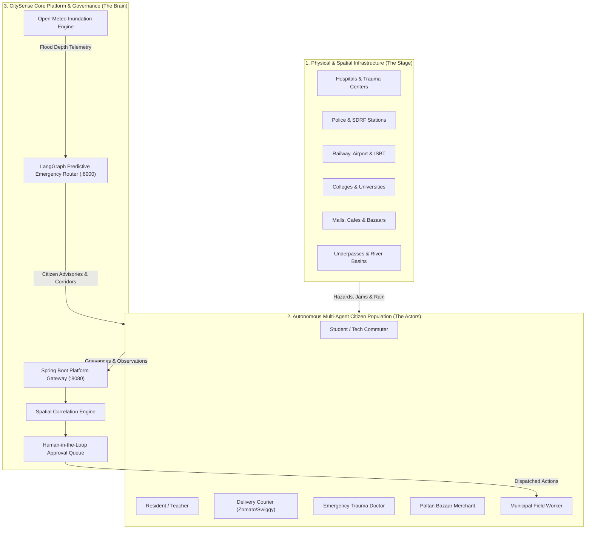
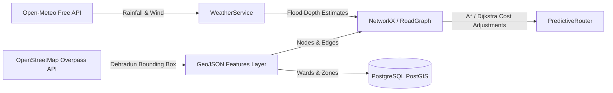
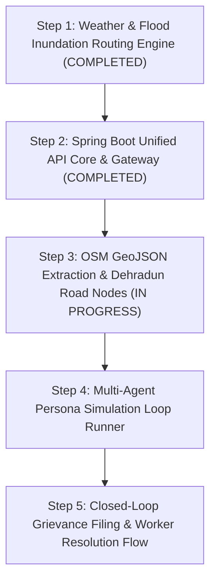

# CitySense: Comprehensive City Simulation & Autonomous Urban Twin Blueprint
**Document Version:** 1.0.0  
**Target City Testbed:** Dehradun Metropolitan Region, Uttarakhand, India  
**Scope:** Urban Topology, Infrastructure Taxonomy, Autonomous Human Agents, and Real-Time Feedback Loop

---

## 1. Executive Overview & Digital Twin Architecture

CitySense transforms smart city management from passive dashboards into an **active, self-healing cyber-physical loop**. Because real-world connected sensors and dynamic crowdsourced telemetry are not always available during development, CitySense embeds an **Autonomous Urban Twin Simulator**.

This simulator models the full operational fabric of **Dehradun** (and extensible to any Indian metropolis like Delhi, Bengaluru, Mumbai). The simulation operates at three tightly integrated layers:



---

## 2. Dehradun Urban Infrastructure Taxonomy

The simulation models real-world landmarks, coordinates, and road networks across the Doon Valley:

### 2.1 Healthcare & Emergency Care Centers
| Facility Name | Category | Coordinates (Lat, Lon) | ER Capacity & Specialization |
| :--- | :--- | :--- | :--- |
| **Doon Hospital** (Govt Medical College) | Level 1 Apex Public Trauma | 30.3180° N, 78.0400° E | 45 ER beds, Burn unit, Primary public trauma facility |
| **Max Super Speciality Hospital** | Tertiary Multi-speciality Private | 30.3800° N, 78.0800° E | 25 ER beds, Advanced cardiac catheterization, Malsi bypass |
| **Synergy Institute of Medical Sciences** | Specialized Trauma & Neuro | 30.3420° N, 78.0120° E | 20 ER beds, Ballupur Chowk critical access |
| **Shri Mahant Indiresh Hospital (SMIH)** | Major Charitable Referral | 30.3110° N, 78.0250° E | 40 ER beds, Patel Nagar / Saharanpur Road gateway |
| **AIIMS Rishikesh** | Regional Super-Apex Referral | 30.0760° N, 78.2880° E | Level 1 national apex trauma referral hub |

### 2.2 Law Enforcement & Disaster Response
| Unit / Station | Role | Coordinates (Lat, Lon) | Primary Jurisdiction |
| :--- | :--- | :--- | :--- |
| **Kotwali Police Station & City Control Room** | Central Command & Patrol | 30.3240° N, 78.0410° E | Paltan Bazaar, Clock Tower, Dhamawala |
| **Dalanwala Police Station** | Residential Precinct | 30.3200° N, 78.0560° E | Dalanwala, EC Road, Survey Chowk |
| **Cantt Police Station** | Defense & Western Sector | 30.3390° N, 78.0210° E | Garhi Cantt, Ballupur, Prem Nagar |
| **Rajpur Police Station** | Foothills & Tourist Highway | 30.3850° N, 78.0920° E | Rajpur Road, Old Mussoorie Road |
| **SDRF Uttarakhand Battalion** | Disaster & Flood Rescue | 30.1900° N, 78.1800° E | Flash flood response, Jolly Grant detachment |
| **Central Fire Station** | Urban Extrication & Hazmat | 30.3210° N, 78.0430° E | Gandhi Park / Rajpur Road intersection |

### 2.3 Transportation & Multi-Modal Transit Hubs
| Terminal | Transit Type | Coordinates (Lat, Lon) | Operational Role |
| :--- | :--- | :--- | :--- |
| **Dehradun Railway Station** | Northern Railway Terminus | 30.3150° N, 78.0350° E | Vande Bharat, Shatabdi, inter-city passenger gateway |
| **Jolly Grant Airport (DED)** | Regional & National Aviation | 30.1897° N, 78.1803° E | 25 km southeast; critical aeromedical & tourist corridor |
| **Inter-State Bus Terminus (ISBT)** | Inter-State & Regional Bus Hub | 30.2880° N, 78.0080° E | NH-72 / Haridwar Bypass; major bus choke point |
| **Dehradun Smart Electric Bus Depot** | Green Intra-City Transit | 30.2950° N, 78.0150° E | Fleet of 30+ e-buses connecting Rajpur, ISBT, Bidholi |
| **Proposed Dehradun-Mussoorie Ropeway** | Aerial Urban Transit | 30.3650° N, 78.0820° E | Purkul Gaon terminal bypassing Rajpur road jams |

### 2.4 Educational & Academic Campuses
| Institution | Type | Coordinates (Lat, Lon) | Population & Transit Impact |
| :--- | :--- | :--- | :--- |
| **UPES (Bidholi & Kandoli Campuses)** | Major Private University | 30.4160° N, 77.9660° E | 15,000+ students; heavy peak morning/evening shuttle flow |
| **Graphic Era (GEU & GEHU)** | Deemed University | 30.2700° N, 78.0080° E | Clement Town; student traffic along Subhash Nagar |
| **DIT University** | Engineering & Tech Campus | 30.3950° N, 78.0750° E | Mussoorie Diversion Road / Makkawala |
| **Forest Research Institute (FRI)** | National Heritage Campus | 30.3420° N, 77.9990° E | Kaulagarh; heritage tourism and eco-sensitive traffic |
| **The Doon School & Welham Schools** | Historic Boarding Institutions | 30.3300° N, 78.0280° E | Mall Road & Dalanwala peak school hour traffic |

### 2.5 Retail, Dining & Commercial Activity Centers
| Venue | Classification | Coordinates (Lat, Lon) | Peak Influx Windows |
| :--- | :--- | :--- | :--- |
| **Paltan Bazaar & Clock Tower Core** | Historic Pedestrian Market | 30.3243° N, 78.0418° E | 11:00 AM - 9:00 PM; dense pedestrian & two-wheeler movement |
| **Pacific Mall (Jakhan, Rajpur Road)** | Modern Retail & Entertainment | 30.3680° N, 78.0730° E | Weekends, Friday evenings; severe Rajpur road slowdowns |
| **Centrio Mall (Hathibarkala)** | Premium Commercial Complex | 30.3410° N, 78.0460° E | Cinema surges, evening dining traffic |
| **Astley Hall & Old Rajpur Cafes** | Dining & Youth Hangouts | 30.3290° N, 78.0470° E | Heavy cafe pedestrian flow, curbside parking congestion |

### 2.6 Critical Low-Lying Underpasses & Inundation Basins
| Drainage / Inundation Hotspot | Vulnerability Index | Critical Threshold | Reroute Bypass Corridor |
| :--- | :--- | :--- | :--- |
| **Rajpur Road / Clock Tower Underpass** | HIGH (Low-lying depression) | $\ge 25.0$ cm water | Subhash Road $\rightarrow$ EC Road Bypass |
| **Rispana River Causeway (Haridwar Rd)** | SEVERE (Flash flood overflow) | $\ge 30.0$ cm water | Ring Road $\rightarrow$ ISBT Bypass |
| **Bindal Bridge / Chakrata Road Dip** | HIGH (Drainage choking point) | $\ge 20.0$ cm water | Cantt Road $\rightarrow$ Ballupur Flyover |
| **Prince Chowk Station Dip** | MODERATE (Railway underpass) | $\ge 15.0$ cm water | Saharanpur Chowk Diversion |

---

## 3. Autonomous Multi-Agent Human Simulation Architecture

Rather than relying on static scripts, CitySense deploys **autonomous persona agents** powered by lightweight LLM/heuristic loops that live in the virtual city, follow circadian daily routines, perceive municipal problems, and actively interact with the platform.

```mermaid
sequenceDiagram
    autonumber
    actor Citizen as Autonomous Citizen Agent (Aarav / Sunita)
    participant Twin as Urban Twin Environment
    participant Spring as Spring Boot Core (:8080)
    participant Correlation as Spatial Correlation Engine
    participant Router as Emergency Router (:8000)
    actor Worker as Municipal Field Worker

    Citizen->>Twin: Commutes along Rajpur Road underpass
    Twin->>Citizen: Inundation Event (Water depth: 32cm, rain: 45mm/h)
    Citizen->>Spring: POST /api/complaints (Photo + Lat/Lon + "Waterlogged underpass")
    Spring->>Correlation: Ingest Observation (type: COMPLAINT)
    Correlation->>Correlation: Correlates with Open-Meteo Rain Observation
    Spring->>Router: Notify Flood Event on segment 'edge_rajpur_underpass'
    Router->>Router: Marks segment impassable; reroutes ambulances via EC Road
    Spring->>Citizen: Push Notification: "Complaint CS-2026-10492 filed. Worker assigned."
    Worker->>Spring: PATCH /api/complaints/{id}/status (RESOLVED, "Drains cleared")
    Spring-->>Citizen: WebSocket Push: "Issue Resolved. Rate resolution."
```

### 3.1 Persona Profiles & Circadian Schedules

```yaml
personas:
  - id: persona_aarav_sharma
    name: "Aarav Sharma"
    archetype: "Student Commuter"
    age: 21
    institution: "UPES Bidholi"
    residence: "Jakhan, Rajpur Road"
    vehicle: "Electric Two-Wheeler"
    routine:
      08:00: "Commute Jakhan -> Bidholi via Mussoorie Bypass"
      17:30: "Commute Bidholi -> Pacific Mall / Cafe"
      20:00: "Return home to Jakhan"
    grievance_triggers:
      - "Potholes along Bidholi hillside road"
      - "Waterlogging near underpass"
      - "Broken streetlights on dark stretches"
    language_preference: "Hinglish / English"

  - id: persona_sunita_rawat
    name: "Sunita Rawat"
    archetype: "Ward Resident & School Teacher"
    age: 44
    residence: "Dalanwala (Ward 14)"
    workplace: "Govt Girls Inter College, Rajpur Rd"
    vehicle: "Walking & City E-Bus"
    routine:
      07:30: "Walk to school via Subhash Road"
      14:00: "Walk to Paltan Bazaar for household groceries"
      16:30: "Return home to Dalanwala"
    grievance_triggers:
      - "Overflowing garbage dumpsters"
      - "Clogged stormwater drains before monsoon"
      - "Stray cattle causing pedestrian hazards"
    language_preference: "Hindi"

  - id: persona_vikram_negi
    name: "Vikram Negi"
    archetype: "Quick-Commerce Delivery Partner (Zomato/Swiggy)"
    age: 26
    vehicle: "Motorcycle"
    operating_zones: ["Clock Tower", "Ballupur", "Rajpur Road", "Chakrata Road"]
    routine:
      11:00 - 23:00: "Continuous multi-stop courier deliveries (18-25 trips/day)"
    grievance_triggers:
      - "Traffic signal deadlocks & unmanaged junctions"
      - "Flash underpass water accumulation"
      - "Minor vehicular accidents observed en route"
    language_preference: "Hindi"

  - id: persona_dr_meera_sen
    name: "Dr. Meera Sen"
    archetype: "Lead Trauma Surgeon"
    residence: "Garhi Cantt"
    workplace: "Doon Hospital (Emergency Trauma Wing)"
    vehicle: "Hospital Emergency Response Car"
    routine:
      "On-call 24x7": "Emergency rapid-transit trips to hospital upon trauma code"
    actions:
      - "Triggers Emergency Route requests"
      - "Requests Green Corridor signal preemption"
```

### 3.2 The Perception-Action Simulation Loop
Each simulated agent runs a lightweight periodic loop (e.g. 1 tick = 10 simulated minutes):
1. **Position Update:** Moves agent along predefined shortest paths between their home, workplace, and leisure nodes.
2. **Sensory Raycast:** Samples environmental conditions at current GPS position:
   - Is road segment water depth $\ge 10$ cm?
   - Is traffic jam delay $> 12$ minutes?
   - Is garbage bin fullness $> 85\%$?
3. **Probabilistic Action Trigger:**
   $$\Pr(\text{File Complaint}) = \min(1.0, \text{Severity} \times \text{Patience Deficit})$$
4. **Natural Language Generation:** Persona builds a realistic complaint title and description (incorporating local vernacular: *"राजपुर रोड अंडरपास में भारी पानी भर गया है, दोपहिया वाहन बंद हो रहे हैं"*).
5. **REST Submission:** Dispatches payload to Spring Boot Core `POST /api/complaints`.

---

## 4. Map Integration & Spatial OpenStreetMap (OSM) Pipeline

To transition from synthetic graphs to real Dehradun geometry:



### 4.1 Bounding Box Specification
* **Min Latitude:** `30.2500° N` (Clement Town / ISBT)
* **Max Latitude:** `30.4200° N` (Mussoorie foothills / UPES Bidholi)
* **Min Longitude:** `77.9500° E` (Selaqui / Bidholi)
* **Max Longitude:** `78.1200° E` (Sahastradhara / Raipur)

### 4.2 OSM Overpass Extraction Queries
* **Roads:** `way["highway"~"primary|secondary|tertiary|residential"](bbox);`
* **Hospitals:** `node["amenity"="hospital"](bbox);`
* **Police Stations:** `node["amenity"="police"](bbox);`
* **Transport:** `node["amenity"~"bus_station|railway_station"](bbox);`
* **Underpasses / Bridges:** `way["tunnel"="yes"](bbox); way["bridge"="yes"](bbox);`

---

## 5. Novel Ideas & Missing Components for Discussion

The following high-value smart city components are recommended for expansion:

### 💡 1. Foothills Micro-Climate & Forest Fire Smoke Surveillance
* **Why it matters:** Dehradun is flanked by the Mussoorie Himalayan ridge to the north and Rajaji National Park to the south. Pre-monsoon forest fires (April–June) generate heavy PM2.5 and localized smoke fog, severely reducing driving visibility on Rajpur Road.
* **Component:** `AirQualitySmokeTracker` combining Open-Meteo Air Quality API with camera edge detectors to issue low-visibility speed restrictions.

### 💡 2. Pilgrim & Tourism Surge Choke Forecasting (Char Dham & Mussoorie)
* **Why it matters:** On Friday evenings and holiday weekends, tourist traffic surging toward Mussoorie chokes Rajpur Road, creating 90-minute deadlocks that trap ambulances bound for Max Hospital.
* **Component:** `TouristSurgePredictor` that automatically adjusts normal speed limits downward by 40% on Rajpur Road when entry tolls at Mohand/Asharodi report incoming vehicle volume $> 1,200 \text{ veh/hr}$.

### 💡 3. Seasonal Riverbank (Rispana & Bindal) Slum Inundation Early Warning
* **Why it matters:** The Rispana and Bindal seasonal streams bisect Dehradun. Cloudbursts in the upper Mussoorie hills cause these dry riverbeds to surge with flash floods within 25 minutes, endangering low-lying informal settlements.
* **Component:** Upstream hydro-telemetry sensor model feeding directly into Member A's `AgentActionService` to trigger automated SMS/WhatsApp evacuation alerts (`ActionType.EVACUATION`).

### 💡 4. Autonomous Civic Inspection Drone Fleet
* **Why it matters:** After heavy rain, ground assessment of 100 municipal wards takes days.
* **Component:** Simulated drone waypoints over major drainage arteries (Bindal, Rispana, Clock Tower Underpass) taking automated aerial snapshots and streaming bounding box CV inferences to `POST /internal/observations`.

### 💡 5. Dynamic Variable Message Signboard (VMS) Network
* **Why it matters:** Smart routing is ineffective if civilian drivers aren't warned before entering flooded bottlenecks.
* **Component:** VMS sign entities placed at entry highways (Mohand Entry, Haridwar Bypass, Rishikesh Road) that display dynamic reroute messages matching the emergency router's decisions.

---

## 6. Verification & Implementation Roadmap



1. **Step 1 (Completed):** Free Open-Meteo weather integration, dynamic water depth penalties, underpass flood bypass routing, citizen proximity warnings.
2. **Step 2 (Completed):** Spring Boot unified REST gateway, Flyway migrations `V1` through `V4`, `CivicController`, `MobilityController`, `AgentGatewayController`, 21 tests passing.
3. **Step 3 (Next):** Ingestion of Dehradun OSM GeoJSON road network with accurate latitude/longitude nodes into Spring Boot database.
4. **Step 4 (Next):** Execution of autonomous multi-agent persona simulation runner generating organic traffic, underpass waterlogging, and crowdsourced grievances.
5. **Step 5 (Next):** End-to-end verification of closed-loop grievance resolution with real-time WebSocket citizen push notifications.
