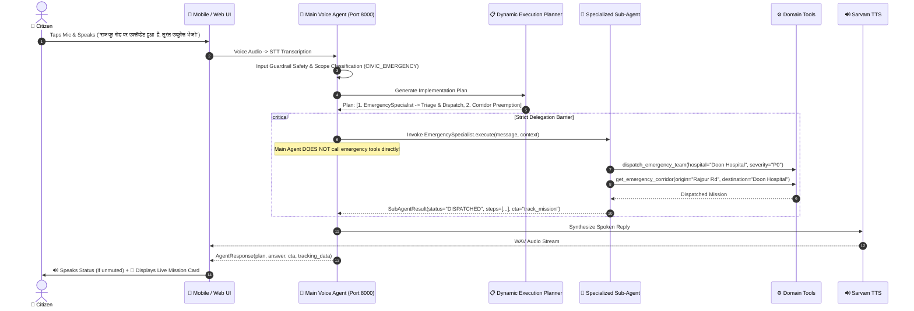
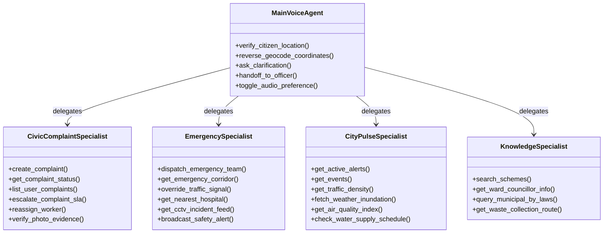

# CITY SENSE: Comprehensive Agentic Architecture & Implementation Plan
> **Target Audience:** Engineering Team & Autonomous Coding Agents (Claude / Antigravity)  
> **Mission:** Production-grade Smart City Platform with Multilingual Voice Agent (STT/TTS), Integrated Planner, Hierarchical Multi-Agent Tool Execution, and 1-Hour Hosting Blueprint.

---

## 1. Executive Summary & Core Invariants

CitySense is an integrated civic AI platform uniting:
1. **Citizen Mobile App (React Native / Expo)**: Interactive civic map, service avatars, citizen grievances, and voice assistant with speaker mute controls.
2. **Main Voice Agent & Dynamic Planner (Port 8000)**: Sarvam AI STT (`saaras:v3`) & TTS (`bulbul:v3`), input safety guardrails, scope classification, and dynamic step-by-step execution planner.
3. **Specialized Sub-Agents**: Domain specialists executing strictly scoped Standard Operating Procedures (SOPs).
4. **Autonomous LangGraph Microservices**: Port 8001 (Civic complaint SLA escalation) and Port 8002 (CCTV vision, feud/accident triage, green-wave corridor preemption).
5. **Spring Boot Gateway (Port 8080)**: PostGIS spatial engine, JWT authentication, geofencing, and unified proxy seam.

### The 3 Core Architectural Invariants

> [!IMPORTANT]
> **Invariant 1: Planner Belongs ONLY to the Main Voice Agent**  
> The Dynamic Planner is integrated exclusively into the Main Voice Agent. Sub-agents do not create arbitrary plans; they execute domain SOPs deterministically.

> [!IMPORTANT]
> **Invariant 2: Strict Delegation & Non-Duplication of Tool Calls**  
> When the Planner assigns a task to a specialized Sub-Agent (e.g. ComplaintAgent, EmergencyAgent), the **Sub-Agent is the sole caller of its domain tools**. The Main Voice Agent **NEVER** calls a tool if another agent is assigned to execute it. The Main Voice Agent directly calls tools **only** when it is the direct executor of a cross-cutting utility tool.

> [!IMPORTANT]
> **Invariant 3: Bi-directional Voice with Speaker Mute Option**  
> Speech input flows via microphone through Sarvam STT. Audio output is synthesized via Sarvam TTS (24kHz WAV). The client UI **must** provide a persistent **Speaker Mute / Unmute toggle** so citizens can listen or read in silence at will.

---

## 2. Voice Pipeline Architecture (STT & TTS)

```mermaid
flowchart LR
    Mic["🎙️ Mobile / Web Mic"] -->|WAV / M4A / WebM| STTRouter["POST /api/agent/voice"]
    STTRouter --> STTLogic["transcribe_with_fallback()"]
    
    subgraph STTEngine["STT Provider Cascade"]
        STTLogic -->|1. Primary| SarvamSTT["Sarvam AI (saaras:v3)<br/>Multilingual Hindi / Hinglish / English"]
        STTLogic -->|2. Fast Failover| GroqSTT["Groq (whisper-large-v3)<br/><500ms latency"]
        STTLogic -->|3. Air-Gapped| LocalSTT["Local Whisper C++"]
    end
    
    SarvamSTT --> TranscribedText["Transcribed Text + Language Code ('hi' / 'en')"]
    TranscribedText --> MainVoiceAgent["🧠 Main Voice Agent & Planner"]
    MainVoiceAgent --> AgentResponse["Agent Answer + Plan Steps + Action Token"]
    
    AgentResponse --> TTSRouter["POST /api/agent/tts"]
    TTSRouter --> TTSLogic["synthesize_speech()"]
    
    subgraph TTSEngine["TTS Engine"]
        TTSLogic --> SarvamTTS["Sarvam AI (bulbul:v3)<br/>Speakers: aditya (m), ritu (f), etc."]
    end
    
    SarvamTTS --> AudioWav["24kHz WAV Binary Stream"]
    AudioWav --> SpeakerToggle{"Speaker Mute Toggle"}
    SpeakerToggle -->|Unmuted| DeviceSpeaker["🔊 Audio Playback"]
    SpeakerToggle -->|Muted| SilentText["💬 Visual Card Only"]
```



### File References & Contracts
- **Provider Implementation**: [`Project/agent_service/src/providers/speech.py`](file:///home/aditya/Desktop/STUDY/SmartCity/Project/agent_service/src/providers/speech.py)
- **STT Endpoint**: `POST /api/agent/voice` (multipart form `file`, optional `language`)
- **TTS Endpoint**: `POST /api/agent/tts` (`{"text": str, "language": "hi"|"en", "speaker": "aditya"|"ritu"}`)

---

## 3. Main Voice Agent & Integrated Dynamic Planner

The Main Voice Agent acts as the front-line civic concierge. It listens to the citizen, creates an execution plan, delegates to sub-agents, and communicates back in natural speech.



---

## 4. Complete 27-Tool Catalog & Ownership Matrix

Every tool in the platform has a **single unambiguous owner**. The Main Voice Agent never executes a tool assigned to a Sub-Agent.



### Detailed Tool Specifications

#### Group A: Cross-Cutting Tools (Owned Directly by Main Voice Agent)
1. **`verify_citizen_location`**: Geocodes informal landmarks ("near Clock Tower", "Rajpur Road Lane 4") to precise GPS lat/lng coordinates via Nominatim proxy.
2. **`reverse_geocode_coordinates`**: Resolves GPS `(lat, lng)` to official Nagar Nigam municipal ward name and postal address.
3. **`ask_clarification`**: Generates targeted conversational follow-up questions when required parameters are missing.
4. **`handoff_to_officer`**: Escalates complex, sensitive, or distressed conversations to human municipal emergency concierge.
5. **`toggle_audio_preference`**: Persists citizen voice playback preference (`auto_play: boolean`, `preferred_speaker: string`).

#### Group B: Civic Grievance Tools (Owned Exclusively by CivicComplaintSpecialist)
6. **`create_complaint`**: Proposes a validated civic ticket with photographic evidence and geographic coordinates. Requires cryptographic token confirmation (`NND-xxxx`).
7. **`get_complaint_status`**: Queries live status, assigned worker, SLA timer, and resolution history by tracking ID.
8. **`list_user_complaints`**: Retrieves all open, pending, and resolved complaints filed by the citizen.
9. **`escalate_complaint_sla`**: Forces an SLA level escalation to the next administrative tier (Ward Supervisor -> Junior Engineer -> Executive Officer -> Municipal Commissioner) via Port 8001.
10. **`reassign_worker`**: Reallocates a delayed or stalled municipal complaint to a rapid-action squad.
11. **`verify_photo_evidence`**: Validates resolution before/after photos using computer vision verification.

#### Group C: Emergency & Public Safety Tools (Owned Exclusively by EmergencySpecialist)
12. **`dispatch_emergency_team`**: Triggers real-time ambulance (108) or police squad dispatch with designated trauma center on Port 8002.
13. **`get_emergency_corridor`**: Computes optimal green-wave corridor between emergency scene and hospital using A* predictive routing.
14. **`override_traffic_signal`**: Sends green-light preemption override command to SUMO / SCATS traffic light controllers along the route.
15. **`get_nearest_hospital`**: Locates nearest government/private hospital with Level 1 trauma care and real-time ICU bed availability.
16. **`get_cctv_incident_feed`**: Queries live vision-detected accidents, road collapses, or public feuds from traffic surveillance streams.
17. **`broadcast_safety_alert`**: Emits geo-fenced broadcast alerts to nearby citizens for active fires, gas leaks, or bridge closures.

#### Group D: City Pulse & Environmental Tools (Owned Exclusively by CityPulseSpecialist)
18. **`get_active_alerts`**: Retrieves active emergency advisories, weather warnings, and scheduled roadworks.
19. **`get_events`**: Queries upcoming cultural events, town hall public hearings, and civic festivals.
20. **`get_traffic_density`**: Returns real-time junction congestion index, vehicle counts, and wait-time telemetry.
21. **`fetch_weather_inundation`**: Telemetry check on waterlogged underpasses (e.g. Rajpur Road Underpass > 25cm) with diversion routes.
22. **`get_air_quality_index`**: Retrieves real-time AQI, PM2.5, and PM10 metrics per municipal ward.
23. **`check_water_supply_schedule`**: Checks Jal Sansthan pipeline water release hours and maintenance outages.

#### Group E: Municipal Knowledge & Civic Services Tools (Owned Exclusively by KnowledgeSpecialist)
24. **`search_schemes`**: Semantic RAG search across verified municipal citizen welfare programs and application requirements.
25. **`get_ward_councillor_info`**: Retrieves ward councillor contact details, constituency office address, and public meeting hours.
26. **`query_municipal_by_laws`**: Answers citizen queries on building bylaws, property tax calculation formulas, and trade licenses.
27. **`get_waste_collection_route`**: Fetches door-to-door sanitation truck schedules and live GPS collection vehicle locations.

---

## 5. Mobile App Audio & UI Architecture

### Component Hierarchy in `Project/mobile/src/app/avatar/[id].tsx`

```text
AvatarChatScreen
├── HeroHeader (Avatar Portrait & Status)
├── MessageThread (ScrollView)
│   ├── UserBubble (Text + Mic badge)
│   └── AgentBubble (Text + Citation tags + Pending Action card + Plan steps)
├── AudioControlsBar
│   ├── SpeakerMuteToggle (🔊 Unmuted / 🔇 Muted icon with visual state)
│   └── WaveformAnimation (Active when recording or speaking)
└── InputDock
    ├── VoiceRecordButton (Hold/Tap to Record -> POST /api/agent/voice)
    ├── TextInputField ("Type your message...")
    └── SendButton (Icon)
```

### Client Audio Implementation Specifications
1. **Audio Recording**:
   - Use cross-platform recording. On React Native/Expo: `expo-av` (`Audio.Recording`).
   - On Web (`ExploreMap.web.tsx` / Web fallback): `navigator.mediaDevices.getUserMedia` + `MediaRecorder`.
   - Recording format: 16kHz or 44.1kHz mono WAV/M4A/WebM blob.
2. **Speaker Toggle & Playback**:
   - Store citizen preference in local storage via [`Project/mobile/src/utils/storage.ts`](file:///home/aditya/Desktop/STUDY/SmartCity/Project/mobile/src/utils/storage.ts) (`voice_auto_play_enabled`).
   - When **Unmuted**: On receiving `AgentResponse`, client automatically invokes `POST /api/agent/tts`, receives WAV binary, and plays via `Audio.Sound.createAsync({ uri })`.
   - When **Muted**: Client suppresses auto-playback. A small play icon appears next to the agent's message so the citizen can click to play selectively.

---

## 6. Spring Boot Gateway Proxy Seam

In [`Project/core/src/main/java/com/citysense/agent/AgentResponder.java`](file:///home/aditya/Desktop/STUDY/SmartCity/Project/core/src/main/java/com/citysense/agent/AgentResponder.java), replace the dummy keyword responder with a reactive HTTP proxy client (`RestClient` or `WebClient`):

```java
@Component
public class AgentResponder {
    private final RestClient restClient;

    public AgentResponder(@Value("${citysense.agent.service-url:http://localhost:8000}") String agentUrl) {
        this.restClient = RestClient.builder().baseUrl(agentUrl).build();
    }

    public AgentDtos.ChatResponse respond(AgentDtos.ChatRequest req) {
        // Forward request payload directly to agent_service (Port 8000)
        // Parse AgentResponse and map into Core ChatResponse DTO with verified citations
    }
}
```

---

## 7. 1-Hour Hosting Blueprint (`docker-compose.yml`)

### Unified Multi-Container Topology

```mermaid
flowchart TD
    PublicInternet["🌐 Public Internet / Port 80 & 443"] --> ReverseProxy["Reverse Proxy (Caddy / Nginx)"]
    
    ReverseProxy -->|/api/agent/*<br/>/api/voice/*<br/>/api/tts/*| AgentService["agent_service:8000<br/>(FastAPI / Uvicorn)"]
    ReverseProxy -->|/api/auth/*<br/>/api/geo/*<br/>/api/avatars/*<br/>/api/complaints/*| CoreService["core:8080<br/>(Spring Boot 3.3)"]
    ReverseProxy -->|/api/complaint-flow/*<br/>/api/feed/*| ComplaintService["complaint_module:8001<br/>(FastAPI / Uvicorn)"]
    ReverseProxy -->|/api/emergency/*<br/>/api/routing/*| EmergencyService["emergency_routing:8002<br/>(FastAPI / Uvicorn)"]
    ReverseProxy -->|/* (Static)| WebApp["Web Portal / UI Dashboard"]
    
    CoreService --> PostgresDB[("postgres-postgis:5432<br/>PostgreSQL 16 + PostGIS")]
    AgentService --> PostgresDB
```

### Complete `docker-compose.yml` Configuration

```yaml
version: "3.8"

services:
  postgres-postgis:
    build: ./db
    image: citysense-db:latest
    container_name: citysense-db
    environment:
      POSTGRES_DB: ${POSTGRES_DB:-citysense}
      POSTGRES_USER: ${POSTGRES_USER:-citysense}
      POSTGRES_PASSWORD: ${POSTGRES_PASSWORD:-citysense}
    ports:
      - "${DB_PORT:-5432}:5432"
    volumes:
      - citysense-pgdata:/var/lib/postgresql/data
    healthcheck:
      test: ["CMD-SHELL", "pg_isready -U $${POSTGRES_USER} -d $${POSTGRES_DB}"]
      interval: 5s
      timeout: 5s
      retries: 20
    restart: unless-stopped

  core:
    build: ./core
    container_name: citysense-core
    depends_on:
      postgres-postgis:
        condition: service_healthy
    environment:
      SPRING_DATASOURCE_URL: jdbc:postgresql://postgres-postgis:5432/${POSTGRES_DB:-citysense}
      SPRING_DATASOURCE_USERNAME: ${POSTGRES_USER:-citysense}
      SPRING_DATASOURCE_PASSWORD: ${POSTGRES_PASSWORD:-citysense}
      JWT_SECRET: ${JWT_SECRET:-dev-only-secret-change-me-please-32-bytes-min!!}
      INTERNAL_API_KEY: ${INTERNAL_API_KEY:-dev-internal-key}
      DEMO_MODE: ${DEMO_MODE:-1}
      SEED_AVATARS: "true"
      SEED_USERS: "true"
    ports:
      - "8080:8080"
    restart: unless-stopped

  agent-service:
    build:
      context: ./agent_service
      dockerfile: Dockerfile
    container_name: citysense-agent
    depends_on:
      - postgres-postgis
    environment:
      DATABASE_URL: postgresql+asyncpg://${POSTGRES_USER:-citysense}:${POSTGRES_PASSWORD:-citysense}@postgres-postgis:5432/${POSTGRES_DB:-citysense}
      JWT_SECRET: ${JWT_SECRET:-dev-only-secret-change-me-please-32-bytes-min!!}
      SARVAM_API_KEY: ${SARVAM_API_KEY}
      GROQ_API_KEY: ${GROQ_API_KEY}
      GEMINI_API_KEY: ${GEMINI_API_KEY}
      DEMO_MODE: "0"
    ports:
      - "8000:8000"
    restart: unless-stopped

  complaint-module:
    build:
      context: ./complaint_module
      dockerfile: Dockerfile
    container_name: citysense-complaints
    environment:
      PORT: 8001
    ports:
      - "8001:8001"
    restart: unless-stopped

  emergency-routing:
    build:
      context: ./emergency_routing
      dockerfile: Dockerfile
    container_name: citysense-emergency
    environment:
      PORT: 8002
      GROQ_API_KEY: ${GROQ_API_KEY}
      GEMINI_API_KEY: ${GEMINI_API_KEY}
    ports:
      - "8002:8002"
    restart: unless-stopped

  reverse-proxy:
    image: caddy:2-alpine
    container_name: citysense-proxy
    depends_on:
      - core
      - agent-service
      - complaint-module
      - emergency-routing
    ports:
      - "80:80"
      - "443:443"
    volumes:
      - ./Caddyfile:/etc/caddy/Caddyfile:ro
      - ./govt_portal:/var/www/html:ro
    restart: unless-stopped

volumes:
  citysense-pgdata:
```

### Production `Caddyfile` Routing Table

```caddyfile
:80 {
    encode gzip zstd

    # Agent Service (Voice STT/TTS & Planner)
    handle /api/agent/* {
        reverse_proxy agent-service:8000
    }
    handle /api/voice/* {
        reverse_proxy agent-service:8000
    }
    handle /api/tts/* {
        reverse_proxy agent-service:8000
    }

    # Emergency Routing & Vision Triage
    handle /api/emergency/* {
        reverse_proxy emergency-routing:8002
    }

    # Complaint Escalation Module
    handle /api/complaint-flow/* {
        reverse_proxy complaint-module:8001
    }

    # Spring Boot Core (Auth, Geo, Avatars, Complaints)
    handle /api/* {
        reverse_proxy core:8080
    }
    handle /avatars/* {
        reverse_proxy core:8080
    }

    # Citizen Web Portal & Static Assets
    handle {
        root * /var/www/html
        file_server
        try_files {path} /index.html
    }
}
```

---

## 8. Step-by-Step Execution Sequence for Claude

When executing this plan:

1. **Step 1: Expand Tool Registry (`agent_service/src/agent/tools.py`)**:
   - Add the Pydantic schemas and execution handlers for all missing tools: `dispatch_emergency_team`, `escalate_complaint_sla`, `verify_citizen_location`, `fetch_weather_inundation`, `get_air_quality_index`, `get_ward_councillor_info`, `override_traffic_signal`, `get_nearest_hospital`.
   - Update `TOOL_MODELS` and `tool_schemas()`.

2. **Step 2: Implement Dynamic Planner in Main Voice Agent (`agent_service/src/agent/orchestrator.py`)**:
   - Build `VoiceAgentPlanner` class.
   - Decompose incoming voice transcription into actionable plan steps.
   - Strictly route domain tasks to `CivicComplaintSpecialist`, `EmergencySpecialist`, `CityPulseSpecialist`, or `KnowledgeSpecialist`.
   - Enforce the **Non-Duplication Invariant**: Main agent only calls cross-cutting tools directly; all domain tools are invoked inside their respective subagents.

3. **Step 3: Update Sub-Agents to Execute New Domain Tools**:
   - `complaint_agent.py`: Execute `escalate_complaint_sla`, `verify_photo_evidence`, `reassign_worker`.
   - `emergency_agent.py`: Execute `dispatch_emergency_team`, `get_emergency_corridor`, `override_traffic_signal`.
   - `city_pulse_agent.py`: Execute `fetch_weather_inundation`, `get_air_quality_index`, `get_active_alerts`.

4. **Step 4: Update Mobile Client with Mic & Speaker Controls (`mobile/src/app/avatar/[id].tsx`)**:
   - Add microphone recording state & trigger (`recordVoice()`).
   - Add speaker mute toggle button (`🔊 / 🔇`) in the chat header.
   - Add audio playback handler that calls `/api/agent/tts` and streams through device audio if unmuted.
   - Display implementation plan steps dynamically in the chat bubble.

5. **Step 5: Bridge Spring Boot `AgentResponder.java`**:
   - Configure HTTP client in `core` to forward free-text avatar chats directly to `agent_service:8000/api/agent/chat`.

6. **Step 6: Dockerize & Launch**:
   - Create Dockerfiles for `agent_service`, `complaint_module`, and `emergency_routing`.
   - Write `Caddyfile` and update `docker-compose.yml`.
   - Run verification suite: STT voice upload -> Planner decomposition -> Subagent execution -> TTS speech generation -> HTTP 200 checks.
